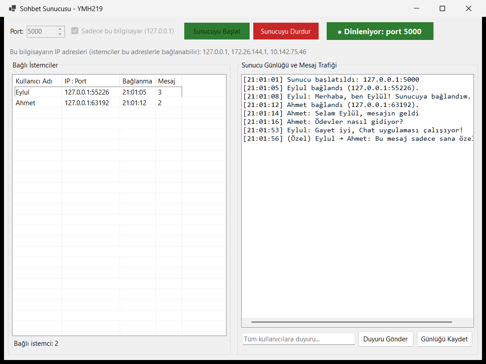
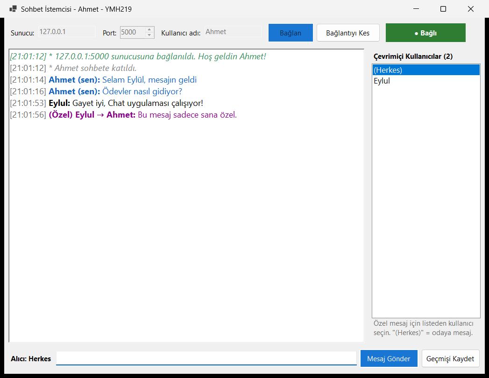
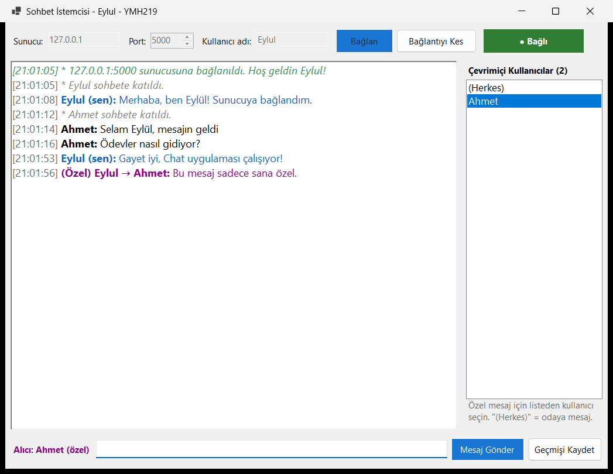

# YMH219-ChatApp — İstemci-Sunucu Chat Uygulaması

**TcpListener / TcpClient** kullanılarak geliştirilmiş, aynı bilgisayarda veya aynı yerel ağda çalışabilen
bir istemci-sunucu sohbet sistemidir. Bir **sunucu** uygulaması ve birden fazla örneği aynı anda
çalıştırılabilen bir **istemci** uygulamasından oluşur. Ağ işlemleri **async/await** ile yapılır; arayüz donmaz.

## Kullanılan Teknolojiler

| Teknoloji | Kullanım Amacı |
|-----------|----------------|
| C# / .NET 10 | Uygulama dili ve platformu |
| Windows Forms (`net10.0-windows`) | Sunucu ve istemci arayüzleri (ListView, ListBox, RichTextBox) |
| `System.Net.Sockets` — `TcpListener`, `TcpClient`, `NetworkStream` | TCP/IP iletişimi |
| `StreamReader` / `StreamWriter` | Satır tabanlı mesaj okuma/yazma |
| `async` / `await`, `Task`, `CancellationToken`, `SemaphoreSlim` | Asenkron ağ işlemleri |
| `System.Text.Json` | Mesajların JSON olarak serileştirilmesi |

> Harici NuGet paketi kullanılmamıştır.

## Proje Yapısı

```
YMH219-ChatApp/
├── ChatApp.sln
├── ChatCore/                      → Ortak sınıf kütüphanesi (sunucu ve istemci birlikte kullanır)
│   ├── Mesaj.cs                   → Mesaj sınıfı + MesajTuru enum'u, tek satırlık JSON protokolü
│   ├── MesajKanali.cs             → TcpClient üzerinde StreamReader/StreamWriter ile okuma-yazma
│   ├── IstemciBaglantisi.cs       → Sunucu tarafında bağlı istemci bilgisi
│   ├── SohbetSunucusu.cs          → TcpListener, bağlantı kabul döngüsü, yayın, özel mesaj
│   └── SohbetIstemcisi.cs         → TcpClient, bağlanma, dinleme döngüsü, hata yönetimi
├── ChatServer/  (SunucuFormu)     → Sunucu arayüzü
└── ChatClient/  (IstemciFormu)    → İstemci arayüzü
```

### Mesaj Protokolü

Her mesaj tek satırlık bir JSON nesnesidir, örneğin:

```json
{"Tur":"Ozel","Gonderen":"Eylul","Alici":"Ahmet","Icerik":"Merhaba","Zaman":"2026-11-25T21:01:56"}
```

1. İstemci bağlanınca ilk mesaj olarak `Baglan` (kullanıcı adı) gönderir.
2. Sunucu `BaglantiKabul` veya `BaglantiRed` (ör. ad kullanımda) ile cevap verir.
3. Sonrasında `Sohbet` (herkese), `Ozel` (tek kişiye), `Sistem` (katıldı/ayrıldı/duyuru) ve
   `KullaniciListesi` mesajları akar. Ayrılırken `Ayril` gönderilir.

## Kurulum ve Çalıştırma

1. Depoyu klonlayın: `git clone https://github.com/eylul1378/NTP-Projelerim.git`
2. `YMH219-ChatApp/ChatApp.sln` dosyasını Visual Studio ile açın.
3. Çözüme sağ tıklayın → **Configure Startup Projects** → **Multiple startup projects** →
   `ChatServer` ve `ChatClient` için **Start** seçin. **F5** ile çalıştırın.
4. Sunucu penceresinde **Sunucuyu Başlat**'a basın (varsayılan port **5000**).
5. İstemcide sunucu adresi, port ve kullanıcı adını girip **Bağlan**'a basın.
   İkinci bir istemci için `ChatClient.exe` dosyasını tekrar çalıştırın.

Komut satırından:

```bash
dotnet run --project YMH219-ChatApp/ChatServer
dotnet run --project YMH219-ChatApp/ChatClient -- Ahmet     # kullanıcı adı parametre olarak verilebilir
```

**Yerel ağda kullanım:** Sunucuda "Sadece bu bilgisayar" seçeneğini işaretlemeyin; sunucu penceresinde
listelenen IP adreslerinden birini istemcide "Sunucu" alanına yazın. Windows Güvenlik Duvarı izin
isterse "Özel ağlar" için izin verin.

## Temel Özellikler

**Sunucu**
- Belirlenen portta istemci bağlantılarını kabul eder (her istemci ayrı bir `Task` içinde dinlenir)
- **Bağlı istemcilerin bilgileri listelenir:** kullanıcı adı, IP:Port, bağlanma zamanı, gönderdiği mesaj sayısı
- Sunucu günlüğü (bağlanma/ayrılma/mesaj trafiği), tüm kullanıcılara **duyuru** gönderme
- Günlüğü .txt olarak kaydetme, bilgisayarın IP adreslerini gösterme
- Port kullanımdaysa anlaşılır hata mesajı

**İstemci**
- **Kullanıcı adı ile bağlanma** (aynı ad kullanımdaysa sunucu reddeder)
- **Bağlan**, **Mesaj Gönder** (Enter ile de gönderilir) ve **Bağlantıyı Kes** işlevleri
- Gönderilen ve alınan mesajlar **zaman bilgisiyle** renkli olarak gösterilir
- Bağlantı durumu göstergesi (Bağlı değil / Bağlanıyor / Bağlı)
- **Hata yönetimi:** sunucu yok, adres bulunamadı, zaman aşımı, bağlantının kopması gibi durumlar
  uygulama kapanmadan kullanıcıya bildirilir

**İsteğe bağlı geliştirmeler**
- **Birden fazla istemcinin aynı odaya katılması** (mesajlar herkese yayınlanır)
- **Özel mesaj:** sağdaki listeden kullanıcı seçilerek yalnızca ona mesaj gönderilir
- **Mesaj geçmişinin dosyaya kaydedilmesi** (Geçmişi Kaydet)

## Ekran Görüntüleri

**Sunucu — bağlı istemciler ve mesaj trafiği**



**İstemci (Ahmet) — oda sohbeti**



**İstemci (Eylul) — özel mesaj**



## Bilinen Sınırlamalar / Geliştirme Notları

- Mesajlar şifrelenmeden (düz TCP) gönderilir; yalnızca yerel ağda ders amaçlı kullanım içindir.
- Tek bir sohbet odası vardır; çoklu oda desteği eklenebilir.
- Sunucu yeniden başlatılırsa istemcilerin tekrar **Bağlan**'a basması gerekir (otomatik yeniden bağlanma yok).

## Öğrenci

- **Ad Soyad:** Nihal Eylül İl
- **Öğrenci No:** 250541001
