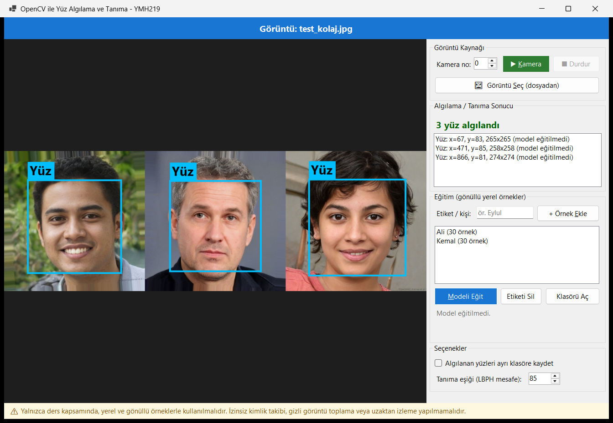
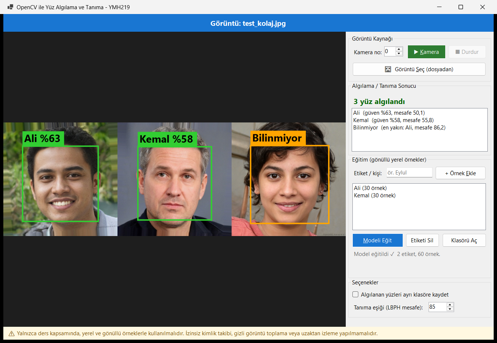

# YMH219-FaceRecognition — OpenCV ile Yüz Algılama ve Tanıma

**OpenCvSharp** (OpenCV'nin C# sarmalayıcısı) kullanılarak kameradan veya dosyadan görüntü alan, yüz
bölgelerini **Haar Cascade** ile algılayıp dikdörtgenle işaretleyen ve küçük, yerel bir örnek kümesi
üzerinde **LBPH** algoritmasıyla temel yüz tanıma/etiketleme yapan bir Windows Forms uygulamasıdır.

> ### ⚠ Kapsam ve Güvenlik Sınırı
> Bu çalışma yalnızca ders kapsamında, **yerel ve gönüllü örneklerle** kullanılmalıdır. Kamuya açık alanlarda
> izinsiz kimlik takibi, gizli görüntü toplama veya gerçek kişileri uzaktan izleme amacıyla kullanılmamalıdır.
> Örnekler ve model yalnızca kullanıcının kendi bilgisayarında saklanır; hiçbir yere gönderilmez.

## Kullanılan Teknolojiler / NuGet Paketleri

| Teknoloji / Paket | Kullanım Amacı |
|-------------------|----------------|
| C# / .NET 10 (`net10.0-windows`) | Uygulama dili ve platformu |
| Windows Forms | PictureBox, ListBox, NumericUpDown, GroupBox |
| **OpenCvSharp4** 4.13 | OpenCV fonksiyonları (`Mat`, `CascadeClassifier`, `VideoCapture`) |
| **OpenCvSharp4.runtime.win** | Windows için yerel OpenCV kütüphaneleri (face modülü dahil) |
| **OpenCvSharp4.Extensions** | `Mat` → `Bitmap` dönüşümü (PictureBox'ta göstermek için) |
| `haarcascade_frontalface_default.xml` | OpenCV'nin ön yüz algılama modeli (`Cascades/` klasöründe) |

## Nesne Tabanlı Tasarım

```
FaceRecognition/
├── Cascades/haarcascade_frontalface_default.xml
├── Services/
│   ├── YuzAlgilayici.cs     → Haar Cascade ile yüz algılama, yüzü 100x100 griye hazırlama
│   ├── YuzTanimaModeli.cs   → LBPH eğitimi, tahmin (etiket + güven), modeli kaydet/yükle
│   ├── VeriKumesi.cs        → Etiket klasörlerinde örnek saklama, algılanan yüzleri kaydetme
│   ├── Kamera.cs            → VideoCapture ile arka planda kare okuma (event ile bildirim)
│   └── GoruntuDosyasi.cs    → Türkçe karakterli yollarda güvenli resim okuma/yazma
├── AnaForm.cs / AnaForm.Designer.cs
└── Program.cs
OrnekVeri/                    → Demo için yapay zekâ ile üretilmiş (gerçek olmayan) kişi görüntüleri
```

## Kurulum ve Çalıştırma

1. Depoyu klonlayın: `git clone https://github.com/eylul1378/YMH219-Nesne-Tabanli-Programlama.git`
2. `YMH219-FaceRecognition/FaceRecognition.sln` dosyasını Visual Studio ile açın (NuGet paketleri otomatik yüklenir).
3. **F5** ile çalıştırın.

Komut satırından: `dotnet run --project YMH219-FaceRecognition/FaceRecognition`

### Kullanım (kendi yüzünüzle)

1. **▶ Kamera** ile kamerayı başlatın; algılanan yüzler mavi dikdörtgenle işaretlenir.
2. **Etiket** alanına adınızı yazın, kameraya farklı açılardan bakarak **+ Örnek Ekle**'ye 10–15 kez basın.
3. İkinci bir gönüllü (veya ikinci bir sınıf) için aynı işlemi tekrarlayın; en az **iki etiket** gerekir.
4. **Modeli Eğit**'e basın. Artık yüzlerin üzerinde tahmin edilen etiket ve güven yüzdesi görünür.

### Hızlı demo (OrnekVeri klasörü ile)

1. **Görüntü Seç** → `OrnekVeri/ali.jpg` → Etiket: `Ali` → **+ Örnek Ekle**
2. **Görüntü Seç** → `OrnekVeri/kemal.jpg` → Etiket: `Kemal` → **+ Örnek Ekle**
3. **Modeli Eğit** → **Görüntü Seç** → `OrnekVeri/test_kolaj.jpg`
   → Ali ve Kemal tanınır, eğitimde olmayan üçüncü kişi **Bilinmiyor** olarak işaretlenir.

> `OrnekVeri` klasöründeki yüzler [thispersondoesnotexist.com](https://thispersondoesnotexist.com) üzerinde
> yapay zekâ (StyleGAN) ile üretilmiştir; **gerçek kişilere ait değildir**. README ekran görüntülerindeki
> model, her kişinin tek fotoğrafından üretilen ayna, parlaklık ve küçük açı çeşitlemeleriyle (30 örnek) eğitilmiştir.

## Temel Özellikler

- **Kamera görüntüsü** veya **seçilen resim** PictureBox'ta gösterilir
- Algılanan her yüz **dikdörtgen** ile işaretlenir (**aynı karede birden fazla yüz** desteklenir)
- **En az iki etiket** ile LBPH tanıma; tahmin edilen **etiket ve güven skoru** görüntü üzerinde ve listede gösterilir
- Eşik değerinin üzerindeki eşleşmeler **"Bilinmiyor"** olarak gösterilir (eşik arayüzden ayarlanabilir)
- **Kamera Başlat / Durdur** ve **Görüntü Seç** işlevleri
- **Hata yönetimi:** kamera açılamazsa / bağlantı koparsa, Haar cascade model dosyası bulunamaz veya bozuksa,
  seçilen dosya resim değilse, tek etiketle eğitilmeye çalışılırsa kullanıcıya anlaşılır mesaj gösterilir
- Eğitilen model `%LocalAppData%\YMH219-FaceRecognition\lbph_model.yml` dosyasına kaydedilir ve açılışta yüklenir

**İsteğe bağlı geliştirmeler**
- **Algılanan yüzleri ayrı klasöre kaydetme** (`AlgilananYuzler/`, saniyede en fazla bir kez)
- **Birden fazla yüzü aynı karede işaretleme**
- **Basit eğitim / veri ekleme ekranı:** örnek ekleme, etiket listesi (örnek sayılarıyla), etiket silme, klasörü açma

## Ekran Görüntüleri

**Yüz algılama (model eğitilmeden) — üç yüz işaretlendi**



**Yüz tanıma — eğitilmiş iki kişi tanındı, üçüncü kişi "Bilinmiyor"**



## Bilinen Sınırlamalar / Geliştirme Notları

- Haar Cascade yalnızca **önden** bakan yüzlerde iyi çalışır; profil ve çok eğik yüzleri kaçırabilir.
- LBPH az örnekle çalışabilen basit bir yöntemdir; ışık ve açı değişimlerine karşı derin öğrenme tabanlı
  yöntemler kadar dayanıklı değildir. Kişi başına 10–20 farklı örnek önerilir.
- OpenCV'nin yerel kodu Türkçe karakter içeren dosya yollarını (ör. `C:\Users\EYLÜL\...`) açamadığı için
  dosyalar .NET ile okunup OpenCV'ye bellekten verilir (`GoruntuDosyasi`, `FileStorage` bellek modu).
- Etiketlerde Türkçe karakter kullanılabilir; yazılar görüntü üzerine GDI+ ile çizilir.

## Öğrenci

- **Ad Soyad:** Nihal Eylül İl
- **Öğrenci No:** 250541001
