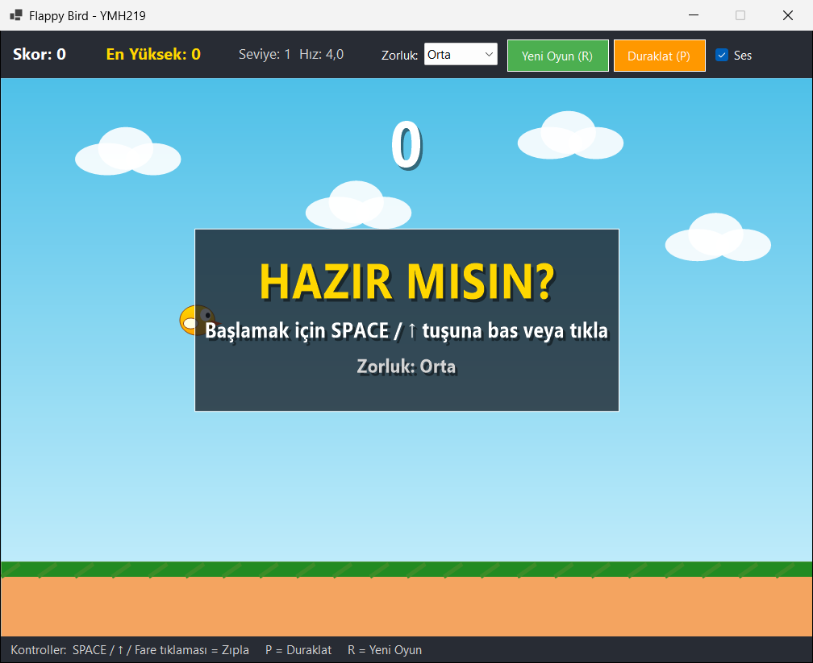
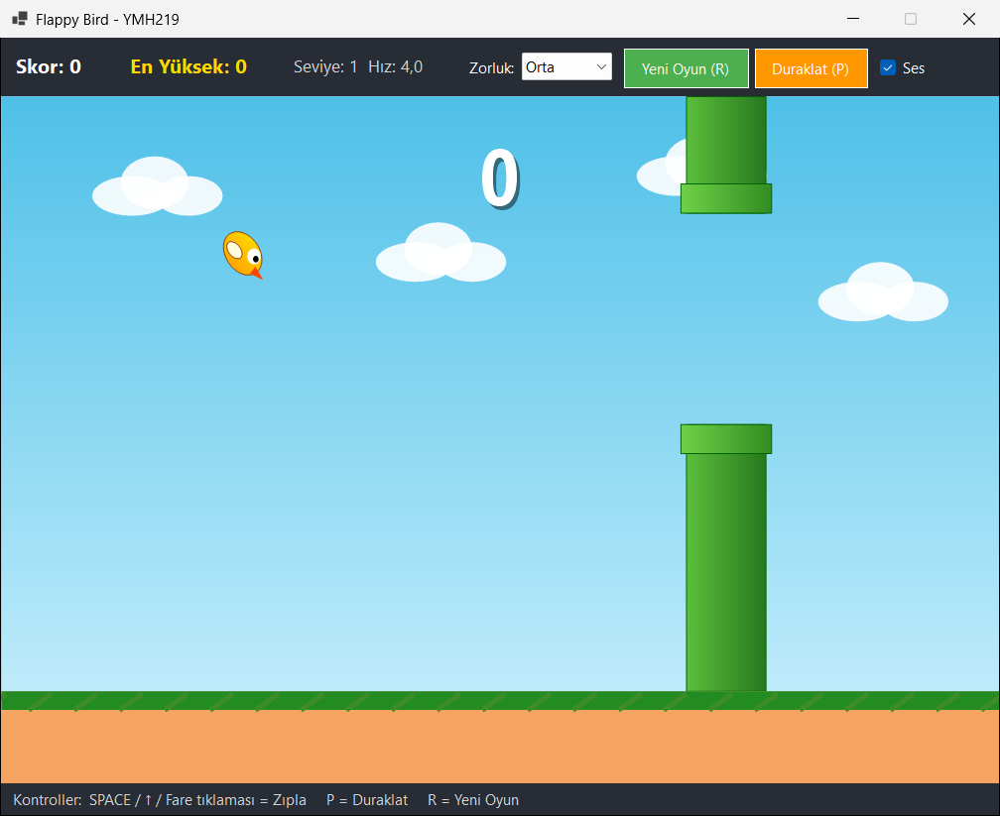
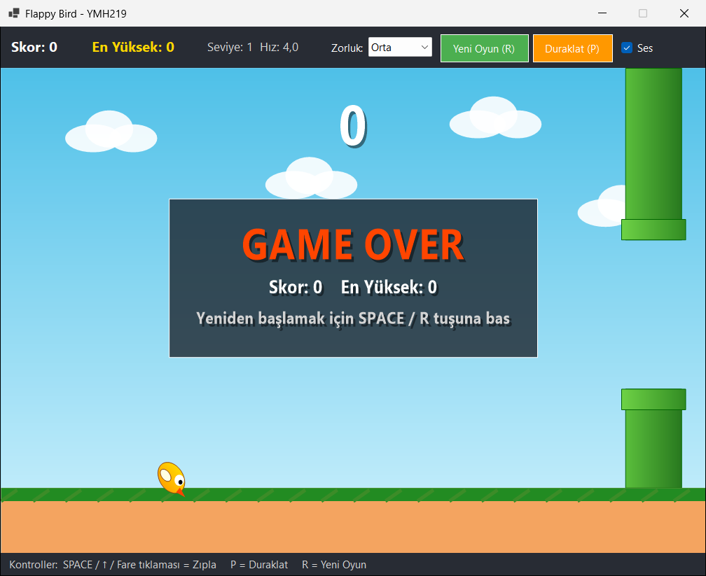

# YMH219-FlappyBird — Flappy Bird Benzeri Masaüstü Oyunu

Windows Forms üzerinde **Timer** ile çalışan oyun döngüsü, **klavye olayları** ve **çarpışma kontrolü**
kullanılarak geliştirilmiş basit bir oyundur. Kuş, oyuncunun tuşa basmasıyla yukarı zıplar, yer çekimi
etkisiyle aşağı düşer; sağdan sola gelen boruların arasından geçtikçe skor artar.

## Kullanılan Teknolojiler

| Teknoloji | Kullanım Amacı |
|-----------|----------------|
| C# / .NET 10 (`net10.0-windows`) | Uygulama dili ve platformu |
| Windows Forms | Form, Panel, Label, Button, ComboBox, CheckBox |
| `System.Windows.Forms.Timer` | ~60 FPS oyun döngüsü (Interval = 16 ms) |
| GDI+ (`System.Drawing`) | Kuş, borular, zemin ve arka planın çizimi |
| `System.Media.SoundPlayer` | Bellekte üretilen WAV ses efektleri |

> Harici NuGet paketi veya resim/ses dosyası kullanılmamıştır; tüm görseller kodla çizilir.

## Nesne Tabanlı Tasarım

```
FlappyBird/
├── Oyun/
│   ├── OyunNesnesi.cs   → abstract taban sınıf (X, Y, Genislik, Yukseklik, Sinirlar, Guncelle(), Ciz())
│   ├── Kus.cs           → OyunNesnesi'nden türer; yer çekimi, Zipla(), dikey hız
│   ├── Boru.cs          → OyunNesnesi'nden türer; üst/alt parça, boşluk, çarpışma, yeniden konumlandırma
│   ├── OyunMotoru.cs    → Oyun durumu (enum), skor, seviye, hız, zorluk, çarpışma ve olaylar (event)
│   ├── SkorKaydedici.cs → En yüksek skoru dosyada saklama
│   └── SesEfektleri.cs  → Zıplama / puan / çarpma sesleri
├── OyunPaneli.cs        → Double-buffered (titremesiz) çizim paneli
└── OyunFormu.cs         → Timer, KeyDown/KeyUp olayları, çizim ve arayüz
```

- **Kalıtım ve çok biçimlilik:** `Kus` ve `Boru`, `OyunNesnesi` soyut sınıfından türer ve `Guncelle()` / `Ciz()` metotlarını ezer (override).
- **Kapsülleme:** Skor, hız, seviye ve durum bilgileri `OyunMotoru` içinde `private set` özelliklerle korunur.
- **Olaylar (event):** `SkorDegisti` ve `OyunBitti` olayları ile form, motorun iç yapısını bilmeden arayüzü günceller.

## Kurulum ve Çalıştırma

1. Depoyu klonlayın: `git clone https://github.com/eylul1378/NTP-Projelerim.git`
2. `YMH219-FlappyBird/FlappyBird.sln` dosyasını Visual Studio ile açın.
3. **F5** ile çalıştırın.

Komut satırından: `dotnet run --project YMH219-FlappyBird/FlappyBird`

### Kontroller

| Tuş | İşlev |
|-----|-------|
| `SPACE` / `↑` / `W` / sol tık | Zıpla (oyun başlamadıysa başlatır) |
| `P` / `ESC` | Duraklat / Devam et |
| `R` / `Enter` | Yeni oyun (yeniden başlat) |

## Temel Özellikler

- Kuş klavye ile **yukarı zıplar**, **yer çekimi** ile aşağı iner (hızına göre eğilir)
- Aynı anda **3 boru (engel)** sağdan sola hareket eder; ekran dışına çıkan boru **yeniden konumlandırılır**
- Kuş boruya veya zemine çarptığında oyun durur ve **GAME OVER** ekranı gösterilir
- Her başarıyla geçilen boru için **skor +1**
- **Yeni Oyun / Yeniden Başlat** butonu ve kısayolu
- **İsteğe bağlı geliştirmeler:**
  - En yüksek skor `%AppData%\YMH219-FlappyBird\enyuksekskor.txt` dosyasında **kalıcı olarak saklanır**
  - Her 5 puanda **seviye atlanır ve oyun hızı artar**
  - **Kolay / Orta / Zor** zorluk seviyeleri (başlangıç hızı ve boşluk yüksekliği değişir)
  - **Ses efektleri** (açılıp kapatılabilir)
  - Duraklatma

## Ekran Görüntüleri

**Başlangıç ekranı**



**Oyun sırasında**



**Game Over**



## Bilinen Sınırlamalar / Geliştirme Notları

- `System.Windows.Forms.Timer` çözünürlüğü yaklaşık 15 ms olduğundan kare hızı bilgisayara göre küçük farklılık gösterebilir.
- Oyun mantığı 880×520 sabit mantıksal alanda çalışır, çizim panel boyutuna ölçeklenir (yüksek DPI ekranlarda da aynı oynanış).
- `SoundPlayer` aynı anda tek ses çalabildiği için art arda gelen seslerde önceki ses kesilir.

## Öğrenci

- **Ad Soyad:** Nihal Eylül İl
- **Öğrenci No:** 250541001
