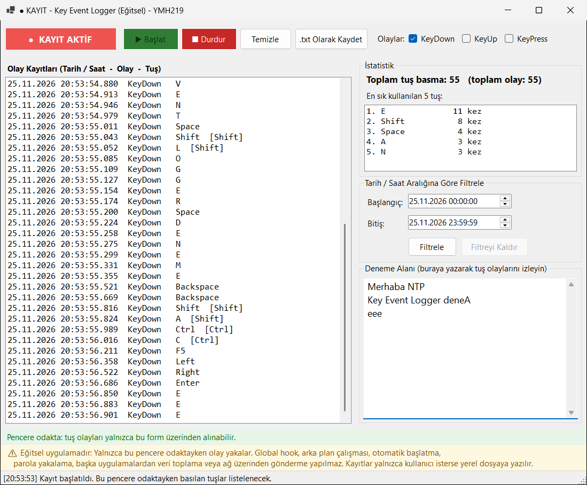
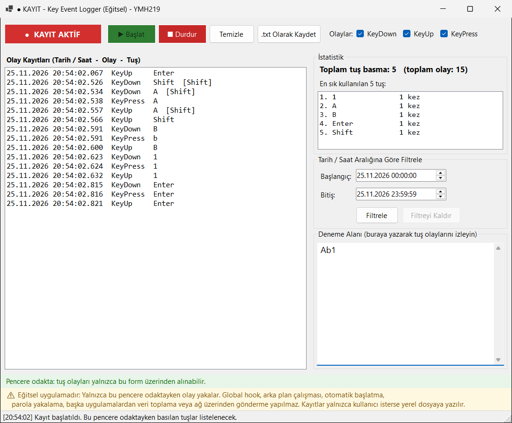

# YMH219-KeyEventLogger — Key Event Logger (Eğitsel Keylogger)

Windows Forms'ta **klavye olaylarının (KeyDown, KeyUp, KeyPress) nasıl yakalandığını** ve olay bilgisinin
uygulama içinde nasıl işlendiğini gösteren eğitsel bir uygulamadır. Uygulama **yalnızca kendi penceresi
odaktayken** basılan tuşları, tarih-saat bilgisiyle listeler ve kullanıcı isterse yerel bir `.txt` dosyasına kaydeder.

> ### ⚠ Kapsam ve Güvenlik Sınırı
> Bu uygulama gerçek bir sistem keylogger'ı **değildir**:
> - Global keyboard hook (`SetWindowsHookEx` vb.) **kullanılmaz**; olaylar yalnızca formun `KeyPreview` özelliği ile alınır.
> - Gizli / arka plan çalışması, başlangıçta otomatik çalışma **yoktur**; uygulama görünür bir penceredir.
> - Parola/kimlik bilgisi yakalama, başka uygulamalardan veri toplama **yapılmaz**.
> - Kayıtlar ağ üzerinden **gönderilmez**; yalnızca kullanıcı "Kaydet" dediğinde, seçtiği yerel dosyaya yazılır.

## Kullanılan Teknolojiler

| Teknoloji | Kullanım Amacı |
|-----------|----------------|
| C# / .NET 10 (`net10.0-windows`) | Uygulama dili ve platformu |
| Windows Forms | ListBox, Button, CheckBox, DateTimePicker, GroupBox, StatusStrip |
| `KeyDown`, `KeyUp`, `KeyPress` olayları + `KeyPreview` | Form içi klavye olaylarının yakalanması |
| System.IO (`StreamWriter`) | Kayıtların .txt dosyasına yazılması |
| LINQ | İstatistik (en sık tuşlar) ve tarih aralığı filtresi |

> Harici NuGet paketi kullanılmamıştır.

## Proje Yapısı

```
KeyEventLogger/
├── Models/TusKaydi.cs          → Tek bir olay kaydı (Zaman, OlayTuru, TusAdi, Değiştiriciler, Karakter)
├── Services/TusKaydedici.cs    → Kayıt listesi, Başlat/Durdur/Temizle, istatistik, filtreleme, olaylar (event)
├── Services/KayitDosyasi.cs    → Kayıtları .txt dosyasına yazma
├── AnaForm.cs / AnaForm.Designer.cs
└── Program.cs
```

## Kurulum ve Çalıştırma

1. Depoyu klonlayın: `git clone https://github.com/eylul1378/NTP-Projelerim.git`
2. `YMH219-KeyEventLogger/KeyEventLogger.sln` dosyasını Visual Studio ile açın.
3. **F5** ile çalıştırın.

Komut satırından: `dotnet run --project YMH219-KeyEventLogger/KeyEventLogger`

## Temel Özellikler

- Pencere aktifken basılan **tuş adı ve zaman bilgisi** (milisaniye hassasiyetinde) ListBox'ta gösterilir
- **Başlat / Durdur** butonları ile kayıt durumu kontrol edilir
- **Temizle** butonu ile ekrandaki kayıtlar silinir (onay sorulur)
- Kayıtlar istenirse **.txt dosyasına kaydedilir** (SaveFileDialog)
- **Kayıt durumu göstergesi:** "● KAYIT AKTİF" (yanıp sönen kırmızı) / "■ KAYIT DURDURULDU" (gri);
  pencere başlığında da durum gösterilir
- Hangi olayların yakalanacağı seçilebilir: **KeyDown / KeyUp / KeyPress**
- Ctrl / Shift / Alt değiştirici tuşları kayıtta gösterilir
- Pencere odağı kaybedildiğinde "başka uygulamalardaki tuşlar yakalanmaz" bilgisi gösterilir
- **İsteğe bağlı geliştirmeler:**
  - **Toplam tuş sayısı** ve **en sık kullanılan 5 tuş** istatistiği
  - Kayıtları **tarih/saat aralığına göre filtreleme**

## Ekran Görüntüleri

**Kayıt aktif — tuş olayları ve istatistik**



**KeyDown, KeyUp ve KeyPress olaylarının birlikte yakalanması**



## Bilinen Sınırlamalar / Geliştirme Notları

- Bir buton odaktayken basılan `Space` / `Enter` tuşları kaydedilir ancak butonu da tetikler; bu nedenle
  kayıt başlatıldığında odak otomatik olarak "Deneme Alanı"na taşınır.
- `Tab`, ok tuşları gibi bazı gezinme tuşları odaktaki kontrol tarafından işlendiğinde `KeyPress` olayı üretmez
  (Windows Forms'un normal davranışıdır).
- Kayıtlar yalnızca bellekte tutulur; uygulama kapatılınca, kaydedilmedilerse silinir.

## Öğrenci

- **Ad Soyad:** Nihal Eylül İl
- **Öğrenci No:** 250541001
