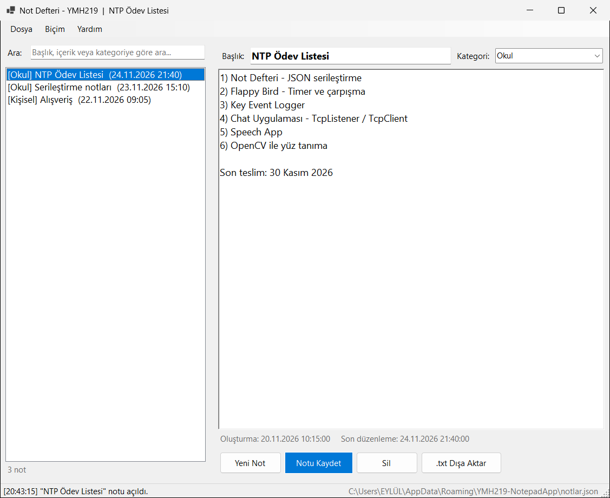
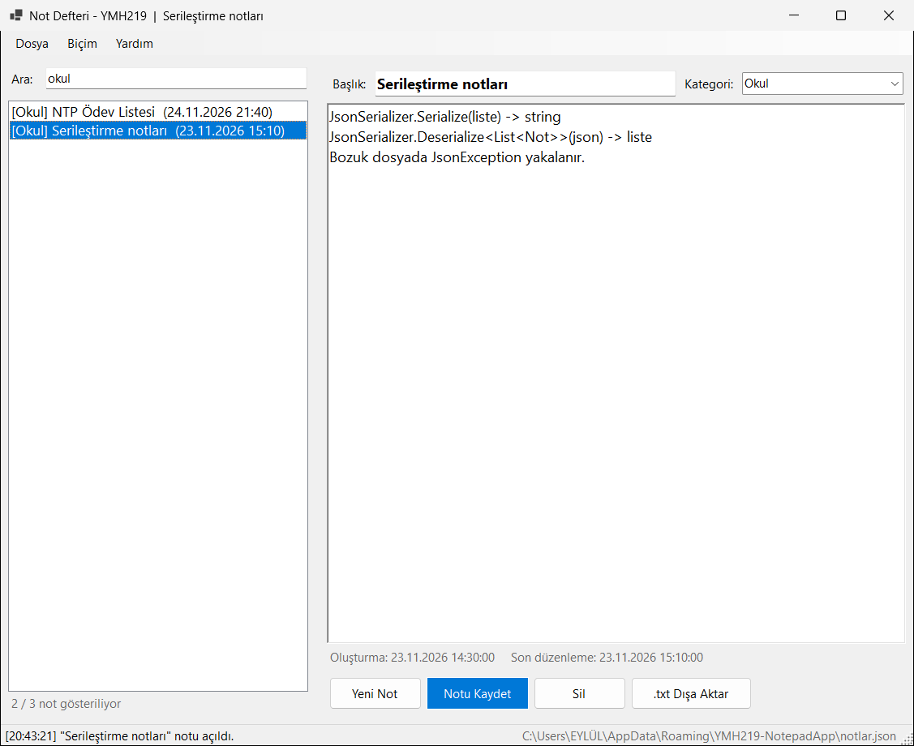
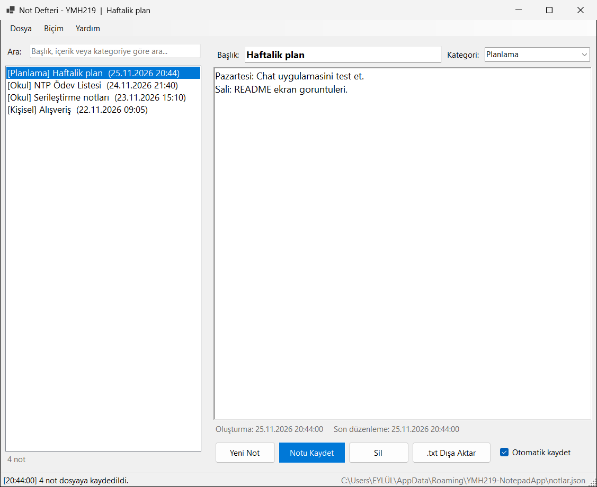

# YMH219-NotepadApp — Not Defteri (Dosya İşlemleri + Serileştirme)

Notları bilgisayarda **kalıcı olarak** saklayan bir Windows Forms not defteri uygulamasıdır.
Notlar `List<Not>` koleksiyonunda tutulur, **System.Text.Json** ile serileştirilerek JSON dosyasına
yazılır ve uygulama açıldığında otomatik olarak geri yüklenir. Uygulama kapatılıp açılsa bile notlar korunur.

## Kullanılan Teknolojiler

| Teknoloji | Kullanım Amacı |
|-----------|----------------|
| C# / .NET 10 (`net10.0-windows`) | Uygulama dili ve platformu |
| Windows Forms | Arayüz (ListBox, TextBox, RichTextBox, ComboBox, MenuStrip, StatusStrip) |
| System.IO (`File`, `StreamReader`, `StreamWriter`) | Dosyaya yazma / okuma, .txt dışa aktarma |
| System.Text.Json | `List<Not>` nesnesinin JSON olarak serileştirilmesi |

> Harici NuGet paketi kullanılmamıştır.

## Proje Yapısı

```
YMH219-NotepadApp/
├── NotepadApp.sln
└── NotepadApp/
    ├── Models/Not.cs                 → Not sınıfı (Başlık, İçerik, Kategori, Oluşturma/Düzenleme tarihi)
    ├── Services/NotDeposu.cs         → List<Not> yönetimi, JSON Kaydet/Yükle, bozuk dosya yedekleme
    ├── Services/TxtDisaAktarici.cs   → Notu .txt olarak dışa aktarma
    ├── AnaForm.cs / AnaForm.Designer.cs → Arayüz ve olaylar
    └── Program.cs
```

## Kurulum ve Çalıştırma

1. Depoyu klonlayın: `git clone https://github.com/eylul1378/YMH219-Nesne-Tabanli-Programlama.git`
2. `YMH219-NotepadApp/NotepadApp.sln` dosyasını Visual Studio ile açın.
3. **F5** ile çalıştırın.

Komut satırından: `dotnet run --project YMH219-NotepadApp/NotepadApp`

Notlar şu dosyada saklanır: `%AppData%\YMH219-NotepadApp\notlar.json`

## Temel Özellikler

- **Not ekleme / listeleme / düzenleme / silme** (başlık + içerik + kategori)
- Her not için **oluşturma** ve **son düzenleme** tarihi tutulur ve gösterilir
- Notlar **JSON** biçiminde dosyaya serileştirilir, açılışta **otomatik yüklenir**
- **Dosya menüsü:** Kaydet (Ctrl+S), Dosyadan Yükle (Ctrl+O), Farklı Kaydet
- Seçili notu **.txt olarak dışa aktarma** (Ctrl+E)
- **Hata yönetimi:**
  - Dosya bulunamazsa (ilk açılış) bilgi verilir, boş listeyle başlanır
  - JSON bozuksa dosya `.bak` olarak yedeklenir, kullanıcı uyarılır, uygulama çökmez
  - Okuma/yazma izin hataları mesaj kutusu ile bildirilir
  - Kaydetme önce geçici dosyaya yapılır, böylece yarıda kalan yazma asıl dosyayı bozmaz
- Kaydedilmemiş değişiklik varken not değiştirme / çıkışta uyarı
- **İsteğe bağlı geliştirmeler:** başlık/içerik/kategoriye göre **arama**, **otomatik kaydetme**,
  **kategori** desteği, RichTextBox ile **kalın / italik / altı çizili / yazı tipi** biçimlendirme

## Ekran Görüntüleri

**Ana ekran — not listesi ve seçili not**



**Arama / filtreleme**



**Yeni not ekleme ve otomatik kaydetme**



## Bilinen Sınırlamalar / Geliştirme Notları

- Biçimlendirme RTF olarak saklanır; .txt dışa aktarmada yalnızca düz metin yazılır.
- Tüm notlar tek bir JSON dosyasında tutulur; çok büyük not sayılarında veritabanı daha uygun olur.
- Aynı dosyanın birden fazla uygulama örneği tarafından aynı anda düzenlenmesi desteklenmez.

## Öğrenci

- **Ad Soyad:** Nihal Eylül İl
- **Öğrenci No:** 250541001
