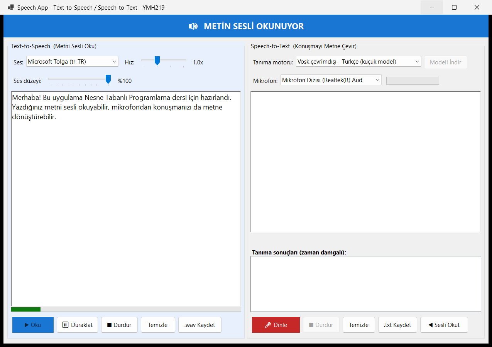
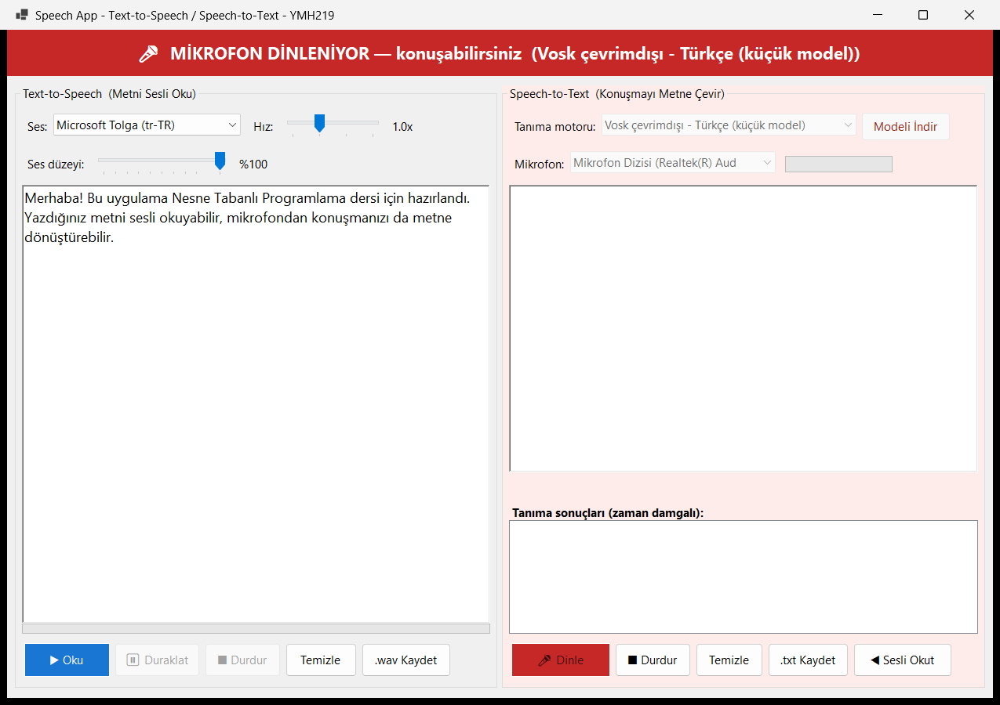

# YMH219-SpeechApp — Speech-to-Text ve Text-to-Speech Uygulaması

Ses ile metin arasında **çift yönlü dönüşüm** yapan bir Windows Forms uygulamasıdır:

- **Text-to-Speech:** Kullanıcının yazdığı metin, Windows'un Türkçe konuşma sesiyle (ör. *Microsoft Tolga*) sesli okunur.
- **Speech-to-Text:** Mikrofondan alınan konuşma, **çevrimdışı** çalışan **Vosk** Türkçe modeli
  (veya bilgisayarda yüklüyse Windows'un konuşma tanıma motoru) ile metne dönüştürülür.

## Kullanılan Teknolojiler / NuGet Paketleri

| Teknoloji / Paket | Kullanım Amacı |
|-------------------|----------------|
| C# / .NET 10 (`net10.0-windows10.0.19041.0`) | Uygulama dili ve platformu |
| Windows Forms | RichTextBox, ComboBox, TrackBar, ProgressBar, ListBox |
| `Windows.Media.SpeechSynthesis` (Windows API) | Metni sese çevirme (Türkçe sesler dahil) |
| **NAudio** 2.2.1 (NuGet) | Sesi çalma (Duraklat/Devam/Durdur) ve mikrofondan 16 kHz kayıt |
| **Vosk** 0.3.38 (NuGet) | Çevrimdışı konuşma tanıma (Türkçe / İngilizce model) |
| **System.Speech** 10.0.0 (NuGet) | Windows'un yerleşik konuşma tanıma motoru (yüklüyse) |

## Nesne Tabanlı Tasarım

```
SpeechApp/
├── Services/
│   ├── MetinSeslendirici.cs     → TTS: sentezleme, Oku/Duraklat/Devam/Durdur, .wav kaydetme, durum olayları
│   ├── IKonusmaTanima.cs        → STT motorları için ortak arayüz (interface) + KonusmaTanimaHatasi
│   ├── VoskKonusmaTanima.cs     → IKonusmaTanima: Vosk + NAudio mikrofon kaydı
│   ├── SistemKonusmaTanima.cs   → IKonusmaTanima: System.Speech (Windows) dikte
│   ├── MotorSecenegi.cs         → Kullanılabilir motorların listelenmesi
│   ├── ModelYoneticisi.cs       → Vosk modelini bulma / indirme / açma
│   └── Mikrofon.cs              → Mikrofon listesi ve hata kodlarının Türkçe açıklaması
├── AnaForm.cs / AnaForm.Designer.cs
└── Program.cs
```

- **Arayüz (interface) ve çok biçimlilik:** Form, tanıma motorunun Vosk mu yoksa System.Speech mi olduğunu
  bilmez; yalnızca `IKonusmaTanima` üzerinden çalışır.
- **Kaynak yönetimi:** Ses çıkışı, mikrofon, tanıyıcı ve model nesneleri `IDisposable` ile serbest bırakılır.
- **Olaylar:** `MetinTanindi`, `AraSonuc`, `SesSeviyesi`, `HataOlustu`, `DurumDegisti`.

## Kurulum ve Çalıştırma

1. Depoyu klonlayın: `git clone https://github.com/eylul1378/NTP-Projelerim.git`
2. `YMH219-SpeechApp/SpeechApp.sln` dosyasını Visual Studio ile açın (NuGet paketleri otomatik yüklenir).
3. **F5** ile çalıştırın.
4. **Speech-to-Text için ilk kullanımda:** "Tanıma motoru" listesinden *Vosk - Türkçe (küçük model)* seçip
   **Modeli İndir** butonuna basın (~35 MB, internet gerekir, bir kez yapılır).
   Model `%LocalAppData%\YMH219-SpeechApp\Models` klasörüne kaydedilir ve depoya eklenmez.
   *Alternatif:* [vosk-model-small-tr-0.3.zip](https://alphacephei.com/vosk/models) dosyasını indirip
   bu klasöre açabilirsiniz.

Komut satırından: `dotnet run --project YMH219-SpeechApp/SpeechApp`

## Temel Özellikler

**Text-to-Speech**
- RichTextBox içindeki metni (veya yalnızca seçili kısmı) sesli okuma
- **Oku (Başlat)**, **Duraklat / Devam**, **Durdur** ve **Temizle** işlevleri
- Okuma ilerleme çubuğu

**Speech-to-Text**
- Mikrofondan alınan konuşma metin alanına aktarılır; konuşurken **ara sonuç** canlı gösterilir
- **Dinle**, **Durdur**, **Temizle** işlevleri, mikrofon seçimi ve **mikrofon ses seviyesi göstergesi**

**Ortak**
- Üstteki büyük göstergede **hangi işlemin aktif olduğu** renkli olarak gösterilir
  (Hazır / Ses hazırlanıyor / Metin okunuyor / Duraklatıldı / Model yükleniyor / Mikrofon dinleniyor)
- **Hata yönetimi:** mikrofon yok, mikrofon izni kapalı veya başka uygulamada, model yok veya bozuk,
  internet yok (model indirme), ses çıkış aygıtı yok gibi durumlarda anlaşılır Türkçe mesajlar
- Klavye kısayolları: **F5** Oku, **F6** Duraklat/Devam, **F7** Durdur, **F9** Dinle, **F10** Dinlemeyi durdur

**İsteğe bağlı geliştirmeler**
- **Ses seçimi**, **okuma hızı** (0.5x – 2.0x) ve ses düzeyi ayarı
- Dönüştürülen metni **.txt dosyasına kaydetme**; okunan metni **.wav** olarak kaydetme
- Tanıma sonuçlarını **zaman damgasıyla listeleme**
- Tanınan metni tek tıkla sesli okutma (◀ Sesli Okut)

## Ekran Görüntüleri

**Text-to-Speech — metin sesli okunuyor**



**Speech-to-Text — mikrofon dinleniyor (Vosk Türkçe model)**



## Bilinen Sınırlamalar / Geliştirme Notları

- Vosk küçük Türkçe model hızlı ve çevrimdışıdır, ancak doğruluğu büyük modellere göre daha düşüktür;
  net ve gürültüsüz konuşmada en iyi sonucu verir.
- Windows'un yerleşik konuşma tanıması (System.Speech) Türkçeyi desteklemez; listede yalnızca bilgisayarda
  yüklü olan dilleri (ör. en-US) gösterilir.
- Mikrofon seviyesi hep 0 kalıyorsa: Windows Ayarlar > Gizlilik ve güvenlik > **Mikrofon** >
  "Masaüstü uygulamalarının mikrofonunuza erişmesine izin verin" açık olmalı ve mikrofon sessize alınmamış olmalıdır.
- Kullanılabilir TTS sesleri Windows'ta yüklü dillere bağlıdır.

## Öğrenci

- **Ad Soyad:** Nihal Eylül İl
- **Öğrenci No:** 250541001
